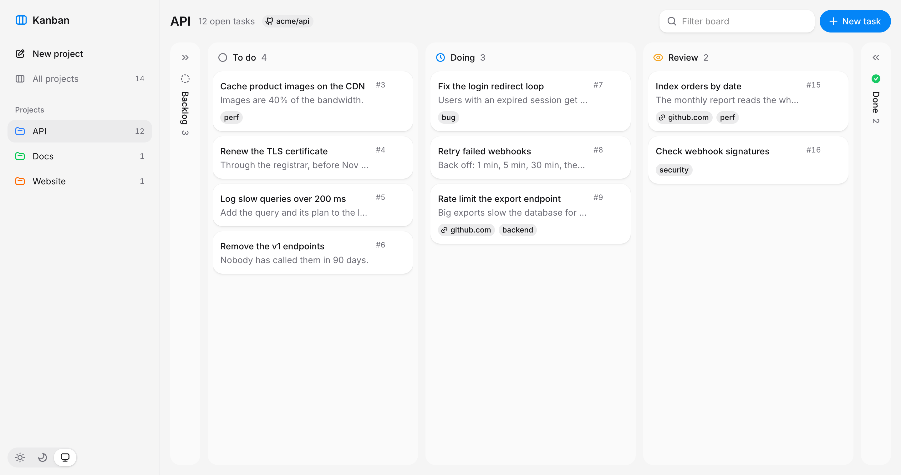

# The example: a kanban board

A kanban board on Hypha Stack, small enough to read in one sitting:
projects, each with its tasks in five columns from the backlog to done,
kept in SQLite by a [Spindle](https://github.com/hyphatech/spindle) server
and shown by islands written in OCaml's JSX on solidtype: Solid
underneath, and HeroUI's ports for what the page shows. It is built
against this checkout, the libraries and the plugin as they are here.

<picture>
  <source media="(prefers-color-scheme: dark)" srcset="board-dark.png">
  
</picture>

```sh
make example        # the page, and the Astro page that mounts the same board
make example-serve  # the API and the built page on http://localhost:4420
```

`make example-serve` serves on port 4420, or the one `BOARD_PORT` names,
and keeps the board in `example/board.db`, or the file `BOARD_DB` names,
migrated by `rowtype-migrate` before the server starts. A file it makes
is given `seed.sql`, three projects and their tasks, by `sqlite3`; remove
the file to start again. `/docs` is the API's interactive document.

## How it fits

```
migrations/        the projects' and tasks' tables, rowtype-migrate
                   migrations
seed.sql           a board to look at, for a new database alone
server/store.ml    the projects and tasks in SQLite through spindle-sqlite's
                   pool, each statement a rowtype value, a colour's and a
                   status's word one for the column and the API alike
server/routes.ml   the store over HTTP, under /api: a name, a title, a
                   repository, a link and labels checked where they enter,
                   a name taken or a project missing refused on its field;
                   a failure of the database is Spindle_sqlite.refusal's
                   answer
server/serve.ml    Spindle serving the routes, their document at /docs,
                   and the built page beside them on one origin, on a pool
                   of the file BOARD_DB names
server/board.ml    the command line, Spindle_cli: the API as OpenAPI, Zod,
                   or the Melange client
server/test_tasks  the routes, called in-process on a file of each test's
                   own, migrated as rowtype-migrate migrates the board's;
                   a server started again on it, a board made before
                   projects migrated, and every statement verified
                   against the tables
src/api.ml         that client, printed by the command line as dune builds
                   src/, never kept: a route that changes is a front end
                   that stops compiling
src/*.mlx          the board: App, its projects and tasks (resources), the
                   project shown, a Search_field that filters it, and
                   Toasts for what happened; Sidebar, the projects to
                   choose, Add_project, each project's Dropdown that
                   deletes it once an Alert_dialog confirms, and the
                   theme by a Segment;
                   Column, a status's tasks, a drop, the first and last
                   folded to a rail; Card, HeroUI's Card with a Dropdown
                   that moves or removes it, its link and labels Chips;
                   Add_task and Add_project, HeroUI's Modal holding its
                   Form, Text_fields and Select, the server's problems
                   shown on the fields they name
src/board.css      HeroUI's styles, the components the board uses, as
                   HeroUI's README gives them; Tailwind reads the board's
                   classes from the .mlx sources
index.html         the page: loads Melange's output from _build; Vite
                   builds it into _build/example-dist, which the server
                   serves
pages/index.astro  the same board as an Astro page, prerendered and
                   hydrated, built into _build/example-astro
test/              the board against the server, in OCaml, run by vitest,
                   on a database migrated for the run
```

In development Vite serves the page and proxies `/api` to the server, and
`dune build --watch` rebuilds the OCaml Vite reads.
